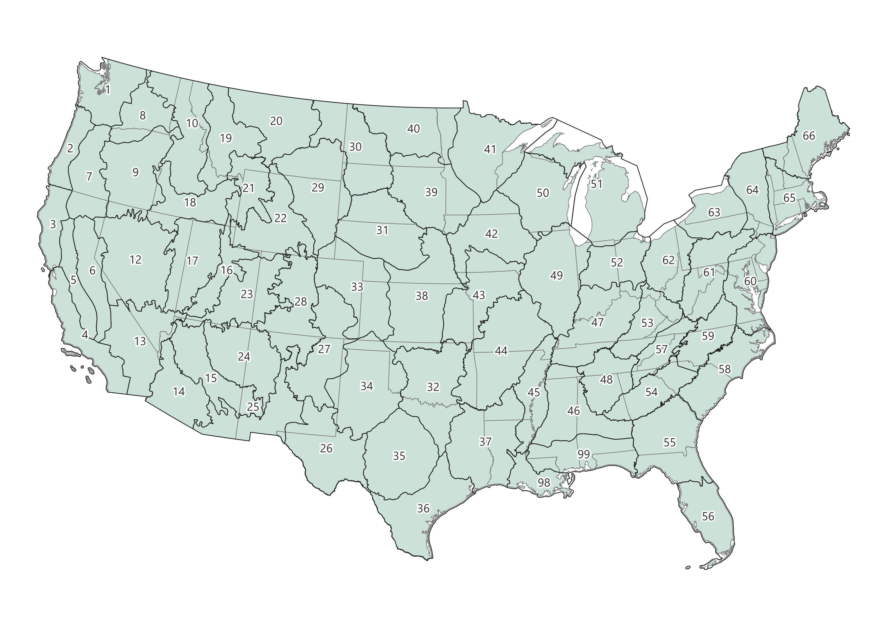

```{r setup, message=FALSE, warning=FALSE, include=FALSE}

library(janitor)
library(tidyverse)
library(stringr)
library(scales)
library(plotly)
library(viridis)
library(DT)
library(tidytext)
library(viridis)
library(gt)
library(knitr)
library(htmltools)
library(kableExtra)


section <- if (exists("params") && !is.null(params$section_na)) {
  params$section_na
} else {
  "Eastern Upper Peninsula"
}

# Read and wrangle raw data ----

## read in and minor wrangle data for vdep and bps x gap (which may not be used, but original code is set this way so keeping)

bps_remove_groups <- c(
  "Barren-Rock/Sand/Clay",
  "Fill-NoData",
  "Fill-Not Mapped",
  "Open Water",
  "Perennial Ice/Snow",
  "Sparse"
)

bps_scls_gap <- read.csv("inputs/bps_scl_gap_sections_2025.csv") |>
  clean_names() |>
  filter(section_na == section) |>
  filter(!groupveg %in% bps_remove_groups) |>
  mutate(raw_acres = round(count * 0.2223945)) |>
  mutate(across(everything(), ~replace(., . == -9999, 0)))

bps_transitions <- read.csv('inputs/bps_transitions.csv')

ref_con <- read.csv("inputs/ref_con_long.csv") |>
  rename(bps_model = model_code)

## read in data for evt-gap protected status-keeping only natural veg

evt_remove_phys <- c(
  "Open Water",
  "Sparsely Vegetated",
  "Developed-Roads",
  "Developed",
  "Developed-Medium Intensity",
  "Developed-Low Intensity",
  "Developed-High Intensity",
  "Quarries-Strip Mines-Gravel Pits-Well and Wind Pads",
  "Agricultural",
  "Snow-Ice",
  "Fill-NoData",
  "Exotic Herbaceous",
  "Exotic Tree-Shrub"
)

evt_gap_status <- read.csv("inputs/evt_gap_sections_2025.csv") |>
clean_names() |>
  filter(section_na == section) |>
  filter(!evt_phys %in% evt_remove_phys) |>
  mutate(acres = round(count * 0.2223945)) |>
  mutate(across(everything(), ~replace(., . == -9999, 0))) 

## by top 10.  commented out august 28 to go with greater than 10k acres below
# top_evt_names <- evt_gap_status |>
#   group_by(evt_name) |>
#   summarize(total_acres = sum(acres, na.rm = TRUE), .groups = "drop") |>
#   arrange(desc(total_acres)) |>
#   slice_head(n = 10) |>
#   pull(evt_name)

# evts with more than 1k acres
top_evt_names <- evt_gap_status |>
  group_by(evt_name) |>
  summarize(total_acres = sum(acres, na.rm = TRUE), .groups = "drop") |>
  filter(total_acres > 1000) |>
  arrange(desc(total_acres)) |>
  pull(evt_name)

evt_gap_status_top10 <- evt_gap_status |>
  filter(evt_name %in% top_evt_names)

# all evt names
all_evt_names <- evt_gap_status |>
  group_by(evt_name) |>
  summarize(total_acres = sum(acres, na.rm = TRUE), .groups = "drop") |>
  arrange(desc(total_acres)) 


# filtered for top evts > 10k acres
# top_evt_names_df <- evt_gap_status_top10 |>
#   group_by(evt_name)|>
#   summarize(acres = sum(acres)) |>
#   arrange(desc(acres))

# all EVTs filtered for top evts > 1k acres
top_evt_names_df <- evt_gap_status |>
  group_by(evt_name) |>
  summarize(acres = sum(acres, na.rm = TRUE)) |>
  filter(acres > 1000) |>
  arrange(desc(acres))


evt_totals <- evt_gap_status_top10 |>
  dplyr::filter(!is.na(gap_sts)) |>
  dplyr::group_by(evt_name, gap_sts) |>
  dplyr::summarize(
    acres = sum(acres, na.rm = TRUE),
    .groups = "drop"
  ) |>
  dplyr::group_by(evt_name) |>
  dplyr::summarize(
    total_acres = sum(acres),
    acres_1_3 = sum(acres[gap_sts %in% 1:3], na.rm = TRUE),
    .groups = "drop"
  )

evt_pad_summary <- evt_gap_status_top10 |>
  dplyr::filter(!is.na(gap_sts), gap_sts %in% 1:3) |>
  dplyr::group_by(evt_name, gap_sts) |>
  dplyr::summarize(
    acres = sum(acres, na.rm = TRUE),
    .groups = "drop"
  ) |>
  tidyr::complete(
    evt_name,
    gap_sts = 1:3,
    fill = list(acres = 0)
  ) |>
  dplyr::left_join(evt_totals, by = "evt_name") |>
  dplyr::mutate(
    pct = dplyr::if_else(total_acres > 0, acres / total_acres, 0),
    pct_sum = dplyr::if_else(total_acres > 0, acres_1_3 / total_acres, 0),
    evt_name = factor(evt_name, levels = top_evt_names_df$evt_name),
    gap_sts = factor(gap_sts, levels = 1:3)
  )


## read in data for bps to evt comparison chart

bps_evt <- read.csv("inputs/bps_evt_sections_2025.csv") |>
  clean_names() |>
  filter(section_na == section)


bps_evt_top50 <- head(bps_evt, n = 50)
 write.csv(bps_evt_top50, file = "bps_evt_top_50.csv")


# prep data for bps bar chart
bps_name_df <- bps_scls_gap |>
  group_by(bps_name) |>
  summarize(acres = sum(raw_acres, na.rm = TRUE)) |>
  filter(acres > 1000) |>
  arrange(desc(acres))

# |>
#   top_n(n = 10, wt = acres)

# prep data for disturbances chart

top_bps <- bps_name_df$bps_name

bps_trans_filt <- bps_transitions |>
  filter(bps_name %in% top_bps)

bps_trans_summarized <- bps_trans_filt |>
  mutate(pct_disturbed_yr = annual_probability * 100) |>
  group_by(bps_name, transition) |>
  summarize(
    pct_disturbed_yr = mean(pct_disturbed_yr, na.rm = TRUE),
    n_models = n(),        # optional but useful for QA
    .groups = "drop"
  )


bps_trans_plot <- bps_trans_summarized |>
  left_join(bps_name_df, by = "bps_name") |>
  mutate(
    bps_name = fct_reorder(bps_name, acres)
  )


## for map?
slugify <- function(x) {
  x <- tolower(x)
  x <- gsub("[^a-z0-9]+", "_", x)
  x <- gsub("^_+|_+$", "", x)
  x
}

locator_img <- file.path(
  "locator_maps",
  paste0(slugify(params$section_na), ".jpg")
)

stopifnot(file.exists(locator_img))


### evt bullets
number_evt <- length(unique(evt_gap_status$evt_name))

top_evt <- evt_gap_status_top10 |>
  slice_max(acres, n = 1) |>
  pull(evt_name)


total_count_evt <- sum(bps_evt$count, na.rm = TRUE)

evt_top10_pct <- bps_evt %>%
  group_by(evt_name) %>%
  summarise(count = sum(count, na.rm = TRUE), .groups = "drop") %>%
  arrange(desc(count)) %>%
  slice_head(n = 10) %>%
  summarise(pct = round(sum(count) / total_count_evt * 100)) %>%
  pull(pct)

# data for bps summary bullets

top_bps_name <- bps_name_df |>
  slice_max(acres, n = 1) |>
  pull(bps_name)

top_bps_acres <- bps_name_df |>
  slice_max(acres, n = 1) |>
  pull(acres)


number_of_bps <- length(unique(bps_scls_gap$bps_model))


total_count_bps <- sum(bps_evt$count, na.rm = TRUE)

bps_top10_pct <- bps_evt %>%
  group_by(bps_name) %>%
  summarise(count = sum(count, na.rm = TRUE), .groups = "drop") %>%
  arrange(desc(count)) %>%
  slice_head(n = 10) %>%
  summarise(pct = round(sum(count) / total_count_bps * 100)) %>%
  pull(pct)

bps_top10_pct


## ===== EVT protection summaries =====

# GAP 1–3 (overall protection)
low_protection_evts <- evt_pad_summary |>
  distinct(evt_name, pct_sum) |>
  arrange(pct_sum) |>
  slice_head(n = 3) |>
  mutate(
    label = paste0(
      evt_name,
      " (",
      scales::percent(pct_sum, accuracy = 1),
      ")"
    )
  )

low_evt_names <- paste(low_protection_evts$label, collapse = "; ")
min_pct <- min(low_protection_evts$pct_sum, na.rm = TRUE)

# GAP 1 (strict protection)
low_gap1_evts <- evt_pad_summary |>
  filter(gap_sts == "1") |>
  distinct(evt_name, pct) |>
  arrange(pct) |>
  slice_head(n = 3) |>
  mutate(
    label = paste0(
      evt_name,
      " (",
      scales::percent(pct, accuracy = 0.1),
      ")"
    )
  )

low_gap1_names <- paste(low_gap1_evts$label, collapse = "; ")

min_gap1_pct <- min(low_gap1_evts$pct, na.rm = TRUE)


## for sankey


evt_colors <- c(
  "Conifer"      = "#00542D",
  "Hardwood"     = "#B3D5A7",
  "Shrubland"    = "#5E3D7F",
  "Grassland"    = "#A4956E",
  "Riparian"     = "#5688C7",
  "Exotics"      = "#F15D50",
  "Agricultural" = "#FFE772",
  "Developed"    = "#999999"
)

groupveg_colors <- c(
  "Conifer"   = "#00542D",
  "Hardwood"  = "#B3D5A7",
  "Shrubland" = "#5E3D7F",
  "Grassland" = "#A4956E",
  "Riparian"  = "#5688C7"
)


bps_evt_norm <- bps_evt %>%
  mutate(
    evt_phys = case_when(
      evt_phys %in% c("Exotic Herbaceous", "Exotic Tree-Shrub") ~ "Exotics",
      evt_phys == "Agricultural"                               ~ "Agricultural",
      evt_phys == "Developed"                                  ~ "Developed",
      grepl("^Developed", evt_phys)                            ~ "Developed",
      grepl("Quarries|Strip Mines|Gravel", evt_phys)           ~ "Developed",
      evt_phys == "Sparsely Vegetated"                         ~ NA_character_,
      TRUE ~ evt_phys
    )
  ) %>%
  filter(!is.na(evt_phys))

top_bps_sankey <- bps_evt_norm %>%
  group_by(bps_name, groupveg) %>%
  summarise(bps_total = sum(count), .groups = "drop") %>%
  arrange(desc(bps_total)) %>%
  slice_head(n = 3) %>%
  mutate(
    bps_pct_total = bps_total / sum(bps_total),
    bps_label = paste0(str_wrap(bps_name, width = 55), " (", percent(bps_pct_total, accuracy = 1), ")"),
    bps_color = dplyr::coalesce(unname(groupveg_colors[groupveg]), "#c8c8c8")
  )
## TABLE


top_bps_summary <- bps_evt_norm %>%
  mutate(bps_model = as.character(bps_model)) %>%
  semi_join(
    bps_scls_gap %>%
      transmute(bps_model = as.character(bps_model)) %>%
      distinct(),
    by = "bps_model"
  ) %>%
  mutate(
    natural_veg = !evt_phys %in% c("Developed", "Agricultural")
  ) %>%
  group_by(bps_name, bps_model) %>%
  summarise(
    total_area = round(sum(count, na.rm = TRUE) * 0.2223945),
    natural_area = round(sum(count[natural_veg], na.rm = TRUE) * 0.2223945),
    converted_area = total_area - natural_area,
    pct_natural_remaining = natural_area / total_area,
    .groups = "drop"
  ) %>%
  arrange(desc(total_area))


## Succession classes

bps_name_number <- read_csv("inputs/bps_model_number_name.csv") |>
  mutate(model_code = as.character(model_code))

sclass_descriptions <- read_csv("inputs/scls_descriptions.csv") |>
  mutate(bps_model = as.character(bps_model))

filtered_sclass <- sclass_descriptions |>
  left_join(
    bps_name_number,
    by = c("bps_model" = "model_code")
  )

# BpS models present in the ecological section being rendered
section_bps_models <- bps_scls_gap |>
  transmute(bps_model = as.character(bps_model)) |>
  distinct()

# Base URL only
url_template <- "https://github.com/rswaty/bps_docs_parse/raw/main/all_bps_docs/"

bps_urls <- filtered_sclass %>%
  mutate(bps_model = as.character(bps_model)) %>%
  semi_join(section_bps_models, by = "bps_model") %>%
  distinct(bps_name, bps_model) %>%
  mutate(
    url = paste0(url_template, bps_model, ".docx"),
    link = paste0(
      '<a href="', url, '" target="_blank">',
      bps_name, " (", bps_model, ")",
      "</a>"
    )
  )
  

# Prepare Current Succession Class Data ----

current_data <- bps_scls_gap |>
  select(count, bps_model, bps_name, label) |>
  unite(model_label, c("bps_model", "label"), remove = FALSE) |>
  group_by(bps_model, model_label, label, bps_name) |>
  summarise(
    count = sum(count),
    .groups = "drop") |>
  group_by(bps_model) |>
  mutate(
    bps_total = sum(count),
    current_percent = round(count / bps_total * 100)) |>
  ungroup()


# Select Most Prevalent BpS Model ----

top_bps_models <- current_data |>
  distinct(bps_model, bps_name, bps_total) |>
  arrange(desc(bps_total)) |>
  slice_head(n = 1)


```

## Introduction

::::: columns
::: {.column width="35%"}
This report helps FSC US forest management certificate holders assess whether native ecosystems are adequately represented and protected in the **`r params$section_na`** Ecological Section. This Ecological Section is the landscape assessed in this report.

Use the report with local information to decide whether Representative Sample Areas (RSAs) are needed within your management unit under Criterion 6.5 of the [FSC US Forest Stewardship Standard V2.0](https://connect.fsc.org/document-centre/documents/resource/242){target="_blank"} (US FSS).
:::

::: {.column width="65%"}
{fig-alt="Locator map for the ecological section"}
:::
:::::

### What this report shows

- **Historical native ecosystems:** The native ecosystems expected under pre-colonization disturbance patterns, given current climate, soils, and other physical conditions.
- **Existing ecosystems:** The ecosystems currently mapped in the landscape.
- **Protection of existing ecosystems:** How much of each existing ecosystem occurs within protected areas and the level of protection those areas provide.

### How to use this report

1.  Identify native ecosystems relevant to your management unit.
2.  Review existing ecosystems and changes within historical native ecosystem areas.
3.  Review protection levels and assess whether the relevant native ecosystems are adequately represented and protected.
4.  Document your findings and determine the applicable RSA next steps.

Use local knowledge and other available information throughout your assessment. If your management unit crosses Ecological Section boundaries, review each relevant report.

### What this report does not determine

This report provides landscape context. It does not identify RSA boundaries, determine whether protection is adequate, or establish conformance with Criterion 6.5.

Local data, finer-scale analysis, field observations, or expert consultation may be needed to complete your assessment. Small or rare ecosystems require particular attention because landscape data may not capture them reliably.

See Criterion 6.5 in the [US FSS](https://connect.fsc.org/document-centre/documents/resource/242){target="_blank"} for the requirements, and Annex G for further guidance.

## Historical native and existing ecosystems

Start by identifying which native ecosystems would typically occur in your management unit given its current climate and soils.

The following charts show historical native ecosystems and existing ecosystems across this Ecological Section. Use them with local information to identify the ecosystems relevant to your management unit.

Historical native ecosystems are modeled estimates, rather than a record of conditions at every site before colonization. Existing ecosystems represent conditions mapped by LANDFIRE in 2024.

The two datasets were developed and revised at different times. Their ecosystem names and categories do not always correspond directly. See Annex A – Understanding the Data for more information.

### Historical native ecosystems

This chart shows the modeled area of each historical native ecosystem covering more than 1,000 acres across the Ecological Section.

The acreage refers to the ecosystem’s total mapped area in the section, not the size of an individual patch.

These landscape data do not capture small or rare ecosystems reliably. Historical native ecosystems mapped across less than 1,000 acres are listed below the chart.

```{r}
#| label: bps chart
#| echo: false
#| message: false
#| warning: false
#| fig.height: 15
#| fig.width: 10

# plot
bps_name_chart <- 
  ggplot(bps_name_df, aes(x = bps_name, y = acres)) +
  geom_bar(stat = "identity", fill = "#00703C") +
  labs(
    subtitle = "",
    caption = "Biophysical Settings (refered to as historical native ecosystems here) data obtained from https://landfire.gov/vegetation/bps.",
    x = "",
    y = "Acres") +
  scale_x_discrete(limits = rev(bps_name_df$bps_name),
                   labels = function(x) str_wrap(x, width = 40)) +
  scale_y_continuous(labels = comma) +
  coord_flip() +
  theme_bw(base_size = 12) +
  theme(
  panel.grid = element_blank(),
  plot.margin = margin(
    t = 5,
    r = 5,
    b = 5,
    l = 40
  )
)


bps_name_chart


```

<br>

```{r}
#| label: small bps list
#| echo: false
#| results: asis

small_bps <- bps_scls_gap |>
  group_by(bps_name) |>
  summarize(acres = sum(raw_acres, na.rm = TRUE), .groups = "drop") |>
  filter(acres < 1000) |>
  arrange(desc(acres)) |>
  pull(bps_name)

cat(
  paste0(
    "**Historical native ecosystems mapped across less than 1,000 acres in this Ecological Section::**\n\n",
    paste0("- ", small_bps, collapse = "\n")
  )
)
```


### Existing ecosystems

This chart shows the mapped area of each existing ecosystem covering more than 1,000 acres across the Ecological Section, using the 2024 LANDFIRE data.

The dataset also includes agricultural land, developed land, and water. These categories help describe the current landscape alongside its ecosystems.

These landscape data do not capture small or rare ecosystems reliably. Existing ecosystems mapped across less than 1,000 acres are listed below the chart.

```{r}
#| label: evt chart
#| echo: false
#| message: false
#| warning: false
#| fig.height: 17
#| fig.width: 10


top_evt_names_df_plot <- top_evt_names_df |>
  filter(acres > 1000)

# plot
evt_name_chart <- 
  ggplot(top_evt_names_df_plot, aes(x = evt_name, y = acres)) +
  geom_bar(stat = "identity", fill = "#333333") +
  labs(
    subtitle = "",
    caption = "Data from https://landfire.gov/vegetation/evt. Developed and agricultural types removed.",
    x = "",
    y = "Acres") +
  scale_x_discrete(
  limits = rev(top_evt_names_df |> filter(acres > 1000) |> pull(evt_name)),
  labels = function(x) str_wrap(x, width = 40)) +
  scale_y_continuous(labels = comma) +
  coord_flip() +
  theme_bw(base_size = 12) +
  theme(
  panel.grid = element_blank(),
  plot.margin = margin(
    t = 5,
    r = 5,
    b = 5,
    l = 40
  )
)


evt_name_chart


```

<br>

```{r}
#| label: small evt list
#| echo: false
#| results: asis

small_evt <- all_evt_names |>
  filter(total_acres < 1000) |>
  arrange(desc(total_acres)) |>
  pull(evt_name)

if(length(small_evt) > 0) {

  cat(
    "**Existing ecosystems mapped across less than 1,000 acres in this Ecological Section:**\n\n"
  )

  cat(
    paste0("- ", small_evt, collapse = "\n")
  )

  cat("\n\n")
}

```

<br>

### Check for small or rare ecosystems

These landscape data may miss or inaccurately map small or rare ecosystems. An ecosystem’s absence from the charts does not establish that it is absent from your management unit or the surrounding landscape.

Review sources such as State Heritage Programs, State Wildlife Action Plans, NatureServe, and local conservation assessments to identify ecosystems that need closer consideration.

::: callout-tip
## Historical native and existing ecosystems

For this Ecological Section:

- LANDFIRE maps **`r number_of_bps`** historical native ecosystem models. Regional versions of an ecosystem model are counted separately.
- The 10 largest historical native ecosystem models cover **`r bps_top10_pct`%** of total mapped area in this Ecological Section.
- The 2024 LANDFIRE data map **`r number_evt`** existing ecosystem and other land cover categories.
- The 10 largest existing ecosystem and land cover categories together cover **`r evt_top10_pct`%** of the total mapped area.
:::

<br>

### Existing conditions within historical native ecosystem areas

The following flow charts show what is currently mapped within the modeled areas of the three largest historical native ecosystems.

They help you understand how those areas are now divided among existing ecosystems and other land cover, including agriculture and development.

For help analyzing additional ecosystems beyond the top three, contact Randy Swaty at [rswaty\@tnc.org](rswaty@tnc.org){target="_blank"} or The Nature Conservancy’s LANDFIRE team at [landfire\@tnc.org](landfire@tnc.org){target="_blank"}.

<br>

**How to read the flow charts:**

- The left side identifies the historical native ecosystem.
- The right side groups existing ecosystems and other land cover into broad categories.
- The connecting bands show how much of the historical native ecosystem’s modeled area falls into each current category. Hover over a band to see its value.

The percentage beside each historical native ecosystem name is its share of the three modeled areas shown, rather than its share of the entire Ecological Section.

Use these charts to identify changes that warrant closer review. They do not establish how much of a historical native ecosystem remains in good ecological condition.

```{r}
#| label: bps to evt
#| echo: false
#| message: false
#| warning: false


make_sankey <- function(bps, bps_label, bps_color) {

  flows <- bps_evt_norm %>%
    filter(bps_name == bps) %>%
    group_by(evt_phys) %>%
    summarise(count = sum(count), .groups = "drop") %>%
    mutate(pct = count / sum(count)) %>%
    arrange(desc(pct))

  nodes <- c(bps_label, flows$evt_phys)

  node_index <- tibble(
    name = nodes,
    id = seq_along(nodes) - 1
  )

  links <- flows %>%
    left_join(node_index, by = c("evt_phys" = "name")) %>%
    mutate(
      source = 0,
      target = id,
      value  = pct,
      label = paste0("Currently ", percent(pct, accuracy = 1), " ", evt_phys
)

    )

  node_colors <- c(
    bps_color,
    ifelse(flows$evt_phys %in% names(evt_colors), evt_colors[flows$evt_phys], "#c8c8c8")
  )

plot_ly(
  type = "sankey",
  orientation = "h",
  node = list(
    label = nodes,
    color = node_colors,
    pad = 18,
    thickness = 20,
    font = list(size = 32),
    hoverinfo = "none"
  ),
  link = list(
    source = links$source,
    target = links$target,
    value  = links$value,
    customdata = paste0(
      "Currently ", percent(links$value, accuracy = 1), " ", flows$evt_phys
    ),
    hovertemplate = "%{customdata}<extra></extra>"
  )
)  |> layout(font = list(size = 18))
}

out <- lapply(seq_len(nrow(top_bps_sankey)), function(i) {
  tagList(
    tags$h3(top_bps_sankey$bps_label[i]),
    make_sankey(
      bps       = top_bps_sankey$bps_name[i],
      bps_label = top_bps_sankey$bps_label[i],
      bps_color = top_bps_sankey$bps_color[i]
    ),
    tags$br(), tags$br()
  )
})

tagList(out)


```

<br>

### Land conversion summary

This table shows how much of each historical native ecosystem’s modeled area is currently mapped as agricultural or developed land. Select a column heading to sort the results.

“Natural Vegetation Remaining” means the area not mapped as agricultural or developed land. It includes exotic vegetation and does not confirm that the historical native ecosystem remains.

Use this table to identify ecosystems whose modeled areas contain substantial agriculture or development. Consider these findings alongside protection levels and local information when assessing representation and protection.

<br>

```{r}
#| label: remining nat veg table
#| echo: false
#| message: false
#| warning: false


top_bps_summary %>%
  mutate(
    pct_num = pct_natural_remaining,   # numeric for sorting
    `Total Area` = comma(total_area),
    `Natural Vegetation Remaining` = comma(natural_area),
    `Converted (Agriculture + Developed)` = comma(converted_area),
    `Percent Natural Vegetation Remaining` = percent(pct_natural_remaining, accuracy = 0.1)
  ) %>%
  select(
    `Native Ecosystem` = bps_name,
    `Model Code` = bps_model,
    `Total Area`,
    `Natural Vegetation Remaining`,
    `Converted (Agriculture + Developed)`,
    `Percent Natural Vegetation Remaining`,
    pct_num
  ) %>%
  datatable(
    rownames = FALSE,
    options = list(
      dom = "t",
      ordering = TRUE,
      pageLength = -1,
      scrollY = "480px",
      scrollCollapse = TRUE,
      columnDefs = list(
        list(visible = FALSE, targets = 6)  # hide the numeric sort col
      )
    )
  ) %>%


formatStyle(
  columns = 1:6,   # only visible columns
  `text-align` = "center"
)


```

<br>

::: callout-note
**Consideration:** Before moving on to the next section, think through which ecosystems have been most impacted by conversion. If a system has largely been converted to agricultural and developed land uses AND it has low levels of protection below, it may be worth additional consideration.
:::

<br>

## Protection of existing ecosystems

This chart shows how much of each existing ecosystem is mapped within lands assigned GAP Status 1, 2, or 3 in the [U.S. Geological Survey’s Protected Areas Database](https://www.usgs.gov/programs/gap-analysis-project/science/pad-us-data-overview){target="_blank"} (PAD-US).

GAP status describes protection from land conversion and the management intent for an area. It helps you assess protection, but does not establish the condition of the ecosystem or whether its protection is adequate.

### What the protection levels mean

The following are simplified explanations. See the PAD-US page linked above for the full descriptions.

- **GAP Status 1:** Permanent protection from conversion, with management to maintain a natural state and allow or mimic natural disturbance.
- **GAP Status 2:** Permanent protection from conversion, with management to maintain a primarily natural state. Some uses or management practices may affect the quality of natural communities.
- **GAP Status 3:** Protection from conversion across most of the area, while allowing extractive uses such as logging or mining.

GAP Status 4 is not shown in this chart.

### How to use the protection chart

Hover over the bars to see the percentage of each existing ecosystem mapped within each protection category.

Review the categories separately. They provide different levels of protection and should not automatically be combined as equivalent evidence of ecosystem conservation.

Low mapped protection can identify ecosystems for closer review. High mapped protection also needs context: consider whether the protected areas contain viable examples and whether their management supports conservation of the native ecosystem.

Use the chart with local information to reach and explain your conclusions about representation and protection. No percentage shown here automatically establishes adequate protection.

```{r}
#| label: protected area
#| echo: false
#| message: false
#| warning: false


evt_pad_summary <- evt_pad_summary |>
  mutate(
    acres_gap = pct * total_acres,

    evt_label = paste0(
      evt_name,
      " (", scales::comma(total_acres), ")"
    ),

    evt_label = factor(
      evt_label,
      levels = unique(
        evt_label[match(top_evt_names_df$evt_name, evt_name)]
      )
    )
  )

evt_pad_summary <- evt_pad_summary |>
  mutate(
    evt_name = factor(
      evt_name,
      levels = top_evt_names_df$evt_name
    )
  )

n_evts <- dplyr::n_distinct(evt_pad_summary$evt_name)

plot_height <- max(
  1100,
  n_evts * 70
)

plot <-
  ggplot(
    evt_pad_summary,
    aes(
      x = evt_label,
      y = pct,
      fill = gap_sts,
      text = paste0(
        "Existing Ecosystem: ", evt_label,
        "<br>Gap Status: ", gap_sts,
        "<br>Percent: ", scales::percent(pct, accuracy = 1),
        "<br>Acres: ", scales::comma(round(acres_gap, 0))
      )
    )
  ) +
  geom_bar(
    stat = "identity",
    position = "stack",
    width = 0.6
  ) +
  coord_flip() +
  scale_x_discrete(
    limits = rev(levels(evt_pad_summary$evt_label)),
    labels = function(x) stringr::str_wrap(x, 25)
  ) +
  scale_y_continuous(
    labels = scales::percent_format(accuracy = 1)
  ) +
  scale_fill_manual(
    values = c(
      "#66A98A",
      "#5E3D7F",
      "#CCCCCC"
    ),
    drop = FALSE,
    na.translate = FALSE
  ) +
  theme_bw(base_size = 12) +
  theme(
    panel.grid = element_blank()
  ) +
  labs(
    fill = "Gap Status",
    subtitle = "Gap Status 1-3 for Existing Ecosystems",
    caption = "Data from landfire.gov and usgs.gov.",
    x = "",
    y = "Percent of Total Existing Ecosystem Protected by GAP Status 1, 2, & 3 within the Ecological Section"
  )

plotly::ggplotly(
  plot,
  height = plot_height,
  tooltip = "text"
) |>
  plotly::layout(
    autosize = TRUE,
    margin = list(
      l = 325,
      r = 40,
      t = 60,
      b = 80
    ),
    xaxis = list(
      fixedrange = TRUE,
      automargin = TRUE
    ),
    yaxis = list(
      fixedrange = TRUE,
      automargin = TRUE
    ),
    dragmode = FALSE,
    bargap = 0.4
  ) |>
  plotly::config(
    scrollZoom = FALSE,
    displayModeBar = FALSE,
    responsive = TRUE
  )


```

<br>

## Next steps after your assessment

### Document your findings

Record the native ecosystems considered, the information used, and your conclusions about representation and protection. Explain how the landscape findings relate to your management unit and identify any information gaps. 

Retain this report with the local information and other evidence supporting your assessment.

### If native ecosystems are adequately represented and protected

Your assessment may conclude that RSA designation is unnecessary. Document the evidence and reasoning supporting that conclusion.

Check the remaining Criterion 6.5 requirements, including restoration provisions and Conservation Areas Network requirements.

### If native ecosystems are not adequately represented and protected

Apply Indicator 6.5.2. Designate viable examples within your management unit as RSAs and manage them to conserve the ecosystem. If viable examples are absent but degraded examples can feasibly be restored, designate those areas as RSAs and manage them to restore more natural conditions.

If suitable examples are absent, or the designated areas are insufficient, review Indicators 6.5.3 and 6.5.4.

Use local information to identify suitable sites and evaluate restoration feasibility. Check any applicable interim provisions in the US FSS.

## Optional information for RSA selection and management

The following information can help you consider ecosystem development stages and historical disturbance patterns when selecting or managing RSAs. It is additional guidance, rather than a separate requirement to designate an RSA for every development stage.

Due to the complexities of multiple variants and scale, we only present the most common historical native ecosystem per chart as an example of the analysis that can be conducted for all remaining ecosystems. Please contact Randy Swaty at [rswaty\@tnc.org](rswaty@tnc.org){target="_blank"} or The Nature Conservancy’s LANDFIRE team at [landfire\@tnc.org](landfire@tnc.org){target="_blank"} for more information. Additionally, the LANDFIRE team and members of the [Conservation Data Lab](https://conservationdatalab.org/){target="_blank"} have put together a [GIS guide that explains how to conduct a succession class analysis on your own using ArcGIS Pro and Microsoft Excel](https://thenatureconservancy.github.io/landfire-guide/){target="_blank"}.

### Ecosystem development stages

Succession classes describe stages of ecosystem development and vegetation structure, such as early development or late development with an open or closed canopy.

The chart compares the modeled reference percentage of each class with the percentage mapped today. Reference percentages estimate the distribution of stages under pre-colonization disturbance patterns.

Use this comparison to investigate stages that are less common today than the model would suggest. The stage with the smallest current percentage is not necessarily underrepresented; its reference percentage may also be small.

Where RSAs are needed, the comparison can help you consider examples containing underrepresented stages. Evaluate differences using local information and consider whether the modeled reference is appropriate under current conditions.

### Reading the succession class labels

* **Early, Mid, and Late** describe developmental stages.
* **OPN** means open canopy; **CLS** means closed canopy; **ALL** includes all canopy conditions.
* **UN** means uncharacteristic native vegetation: native vegetation whose current structure falls outside the model’s reference classes.
* **UE** means uncharacteristic exotic vegetation.

See the linked ecosystem reference document below for the species and vegetation structure associated with each class.

An ecosystem may have several regional model versions. This chart uses the single most widespread version in the Ecological Section rather than combining versions with different reference conditions.

<br>

```{r}
#| label: sclass chart
#| echo: false
#| message: false
#| warning: false
#| fig.height: 9
#| fig.width: 11

# Prepare Current Succession Class Data ----

current_data <- bps_scls_gap |>
  select(count, bps_model, bps_name, label) |>
  unite(model_label, c("bps_model", "label"), remove = FALSE) |>
  group_by(bps_model, model_label, label, bps_name) |>
  summarise(
    count = sum(count),
    .groups = "drop") |>
  group_by(bps_model) |>
  mutate(
    bps_total = sum(count),
    current_percent = round(count / bps_total * 100)) |>
  ungroup()


# Select Most Prevalent BpS Model ----

message("section: ", section)
message("top bps model: ", top_bps_models$bps_model[[1]])
message("top bps name: ", top_bps_models$bps_name[[1]])
message(
  "disturbance rows: ",
  sum(bps_transitions$bps_name == top_bps_models$bps_name[[1]]))
message(
  "document rows: ",
  sum(bps_urls$bps_model == top_bps_models$bps_model[[1]]))

top_bps_models <- current_data |>
  distinct(bps_model, bps_name, bps_total) |>
  arrange(desc(bps_total)) |>
  slice_head(n = 1)


top_bps_doc <- bps_urls |>
  filter(bps_model == top_bps_models$bps_model[[1]]) |>
  pull(link) |>
  first()


# Prepare Reference Succession Class Data ----

aoi_ref_con <- ref_con |>
  filter(bps_model %in% top_bps_models$bps_model) |>
  select(
    bps_model,
    model_label,
    ref_percent,
    ref_label) |>
  filter(!endsWith(model_label, "_Water")) |>
  rename(label = ref_label)


# Prepare Succession Class Labels ----

sclass_labels <- sclass_descriptions |>
  filter(bps_model %in% top_bps_models$bps_model) |>
  select(
    bps_model,
    label,
    class_id) |>
  distinct()


# Combine Reference and Current Data ----

scls_data <- aoi_ref_con |>
  left_join(
    current_data |>
      select(
        bps_model,
        bps_name,
        bps_total,
        model_label,
        label,
        count,
        current_percent),
    by = c(
      "bps_model",
      "model_label",
      "label")) |>
  left_join(
    sclass_labels,
    by = c(
      "bps_model",
      "label")) |>
  mutate(
    bps_name = coalesce(
      bps_name,
      top_bps_models$bps_name[[1]]),
    bps_total = coalesce(
      bps_total,
      top_bps_models$bps_total[[1]]),
    count = replace_na(count, 0),
    ref_percent = replace_na(ref_percent, 0),
    current_percent = replace_na(current_percent, 0),
    class_id = coalesce(class_id, label),
    class_label = case_when(
      label == "UN" ~ "UN",
      label == "UE" ~ "UE",
      TRUE ~ class_id)) |>
  pivot_longer(
    cols = c(ref_percent, current_percent),
    names_to = "ref_cur",
    values_to = "percent") |>
  mutate(
    ref_cur = factor(
      ref_cur,
      levels = c(
        "current_percent",
        "ref_percent"),
      labels = c(
        "Present",
        "Reference")))


# Order Succession Classes ----

class_levels <- scls_data |>
  distinct(label, class_id) |>
  mutate(
    class_label = case_when(
      label == "UN" ~ "UN",
      label == "UE" ~ "UE",
      label == "Agriculture" ~ "Agriculture",
      label == "Developed" ~ "Developed",
      TRUE ~ class_id),
    class_order = match(
      label,
      c(
        "A",
        "B",
        "C",
        "D",
        "E",
        "UN",
        "UE",
        "Agriculture",
        "Developed"))) |>
  arrange(class_order) |>
  pull(class_label)

scls_data <- scls_data |>
  mutate(
    class_label = case_when(
      label == "UN" ~ "UN",
      label == "UE" ~ "UE",
      label == "Agriculture" ~ "Agriculture",
      label == "Developed" ~ "Developed",
      TRUE ~ class_id))


# Create Chart Labels ----

top_bps_chart_name <- top_bps_models$bps_name[[1]]

top_bps_chart_model <- top_bps_models$bps_model[[1]]

sclass_chart_subtitle <- paste0(
  top_bps_chart_name,
  " | LANDFIRE BpS Model ",
  top_bps_chart_model)


# Plot Succession Classes ----

sclasplot <-
  ggplot(
    scls_data,
    aes(
      x = class_label,
      y = percent,
      fill = ref_cur)) +
  geom_col(
    width = 0.72,
    position = position_dodge(width = 0.78)) +
  coord_flip() +
  scale_x_discrete(
    limits = rev(class_levels),
    labels = function(x) stringr::str_wrap(x, width = 35)) +
  scale_y_continuous(
    labels = scales::label_percent(scale = 1),
    expand = expansion(mult = c(0, 0.05))) +
  scale_fill_manual(
    values = c(
      "Present" = "#4E84AF",
      "Reference" = "#66A98A"),
    name = NULL) +
  labs(
    title = sclass_chart_subtitle,
    caption = "Data from landfire.gov.",
    x = NULL,
    y = "Percent of BpS model area") +
  theme_bw(base_size = 13) +
  theme(
    legend.position = "top",
    legend.justification = "left",
    plot.title.position = "plot",
    plot.caption.position = "plot",
    plot.caption = element_text(
      hjust = 0,
      face = "italic"))

sclasplot
```

<br>

**Reference document for the most common historical native ecosystem for this Ecological Section:**

`r top_bps_doc`

### Historical disturbance patterns

This chart estimates the percentage of the ecosystem affected annually by different disturbance types under historical reference conditions.

Use it as background for understanding how disturbance helped shape the ecosystem and its development stages.

The chart does not show current disturbance rates, predict future threats, or prescribe how much of an RSA to disturb. Any use of these estimates in management planning needs to account for current site conditions, climate, and the area’s conservation objectives.


```{r}
#| label: disturbances
#| echo: false
#| message: false
#| warning: false
#| fig.height: 6
#| fig.width: 11

# Historical Disturbance Regime ----

top_bps_model_dist <- top_bps_models$bps_model[[1]]
top_bps_name_dist <- top_bps_models$bps_name[[1]]

trans_levels <- bps_transitions |>
  filter(model_code == top_bps_model_dist) |>
  distinct(transition) |>
  arrange(transition) |>
  pull(transition)

bps_trans_plot <- bps_transitions |>
  filter(model_code == top_bps_model_dist) |>
  mutate(
    pct_disturbed_yr = annual_probability * 100,
    transition = factor(
      transition,
      levels = rev(trans_levels)))

ggplot(
  bps_trans_plot,
  aes(
    x = pct_disturbed_yr,
    y = transition)) +
  geom_col(width = 0.55) +
  scale_x_continuous(
    labels = label_percent(scale = 1),
    expand = expansion(mult = c(0, 0))) +
  labs(
    title = top_bps_name_dist,
    subtitle = paste0(
      "LANDFIRE BpS Model ",
      top_bps_model_dist),
    x = "Percent disturbed per year",
    y = NULL) +
  theme_bw(base_size = 13) +
  theme(
    panel.grid.minor = element_blank(),
    plot.margin = margin(
      t = 5,
      r = 0,
      b = 5,
      l = 0))

```


## Annex A: Understanding the data

### Historical native ecosystems — Biophysical Settings

LANDFIRE’s Biophysical Settings data model the native ecosystems expected under pre-colonization disturbance patterns, given current climate, soils, and other physical conditions. This report calls them historical native ecosystems.

Each ecosystem model has a description of its characteristic species, structure, and disturbance patterns, together with estimates of its reference succession class distribution.

### Existing ecosystems — Existing Vegetation Type
LANDFIRE’s Existing Vegetation Type data map ecosystems currently present in the landscape. The dataset also includes agricultural land, developed land, water, and other cover categories.

Although the dataset names differ, both Biophysical Settings and Existing Vegetation Type describe ecosystems. They were developed and revised at different times, so ecosystem names and categories do not always correspond directly.

### Ecosystem development stages — Succession Classes

LANDFIRE’s Succession Classes describe vegetation structure and ecosystem development. This report compares mapped current classes with the reference percentages estimated by the ecosystem models.


### Protection levels — PAD-US GAP Status

PAD-US identifies protected areas and assigns GAP status codes based on protection from conversion and management intent. These codes describe protection categories; they do not directly measure ecosystem condition.

<br> 

All of these datasets provide landscape information. Check their findings against local information before making any conclusions.


## Annex B: Historical native ecosystem descriptions

To better understand ‘reference’ conditions for the historical native ecosystems of the US, the LANDFIRE program developed descriptions plus accompanying state-and-transition models that depict how these systems ‘looked and functioned’ with natural disturbance regimes. Below you can download the descriptions for this section’s Native Ecosystems and explore the succession class descriptions in a table.

LANDFIRE developed and delivers this information by Map Zone. If an ecosystem crosses multiple Map Zones there may be multiple ‘variants’. In the table of links to the descriptions you will see “Model Codes”, which represent an unique 5 digit code for the system followed by a list of Map Zones that description applies to.




```{r}
#| label: bps_urls
#| echo: false
#| message: false
#| warning: false


datatable(
  bps_urls %>%
    select(
      `Native Ecosystem` = bps_name,
      `Model Code` = bps_model,
      `Document` = link),
  escape = FALSE,
  rownames = FALSE,
  options = list(
    dom = "fltip",
    pageLength = 10))


```
